<p align="center"><strong>Deutsch</strong> · <a href="README.md">English</a></p>

<p align="center">
  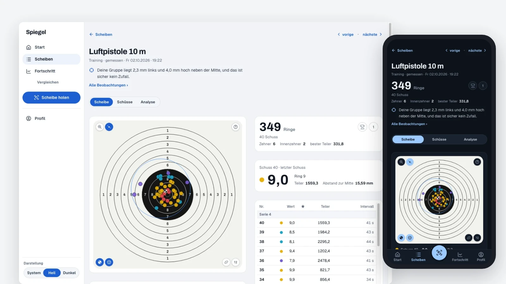
</p>

<h1 align="center">vereinsheim</h1>

<p align="center"><strong>Jeder Schuss, genau wie er saß.</strong><br>
Quelloffene Software für Schützenvereine, auf dem eigenen Server.</p>

<p align="center">
  
  
  
  
  
</p>

**Spiegel** nimmt die Rohdaten, die die Meyton-Anlage des Vereins ohnehin aufzeichnet, Lage auf 1/100 mm, Ring, Zehntel,
Teiler, Zeit auf die Millisekunde, und zeigt sie dem Schützen, der sie geschossen hat: am Telefon auf dem Heimweg, am
Desktop für den genauen Blick. **Ringwerk** führt Liga und Wettkämpfe des Vereins. Beides läuft nebeneinander auf einem
kleinen Server. Die Daten der Mitglieder verlassen ihn nicht.

---

## Spiegel

<p align="center">
  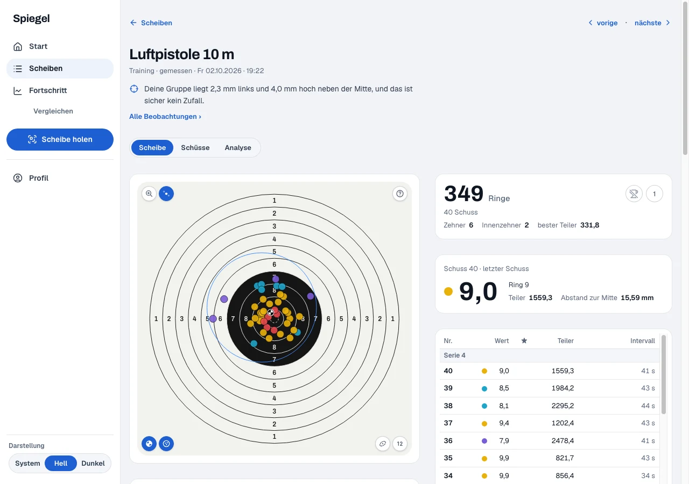
</p>

- **Eine Scheibe, jeder Schuss.** Das Schussbild mit allen Schüssen, Serien, die Schusstabelle mit Lage, Ring, Zehntel,
  Teiler und Zeit, Wertung ganz und in Zehnteln nebeneinander.
- **Analyse in sechs Reitern.** Lage, Streuung, Rhythmus, Verlauf und mehr, jede Kennzahl mit Hilfe in einfacher
  Sprache. Wo die Daten keinen Schluss tragen, sagt Spiegel „unklar“.
- **Fortschritt über Wochen.** Trend, Umfang, ein Trainingskalender, Vergleich mit jedem Zeitraum, Bestwerte.
- **Vergleichen.** Zwei Zeiträume, Training gegen Wettkampf, oder zwei Scheiben Schuss für Schuss.
- **Scheibe holen.** QR-Code auf dem Meyton-Ausdruck scannen, das PDF ablegen oder die ID eintippen: Die Scheibe gehört
  dem Schützen.
- **Privat von Anfang an.** Eine Scheibe wird einem Schützen erst zugeordnet, wenn er mit seiner Sportpassnummer
  zugestimmt hat. Admins verwalten Konten und sehen keine fremden Schüsse. Verdeckte Wertungen bleiben im Schützenhaus.
- **Tagebuch.** Einheiten, Ziele mit messbarem Kriterium, Routinen und eine Analyse, was die Form beeinflusst.

<table>
  <tr>
    <td>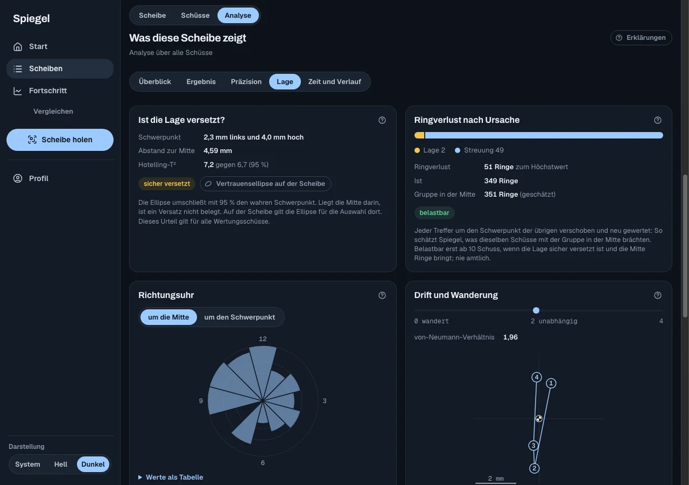</td>
    <td>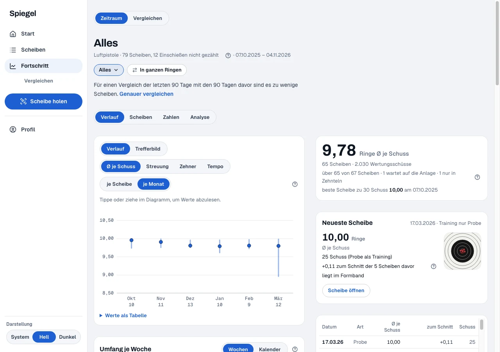</td>
  </tr>
  <tr>
    <td>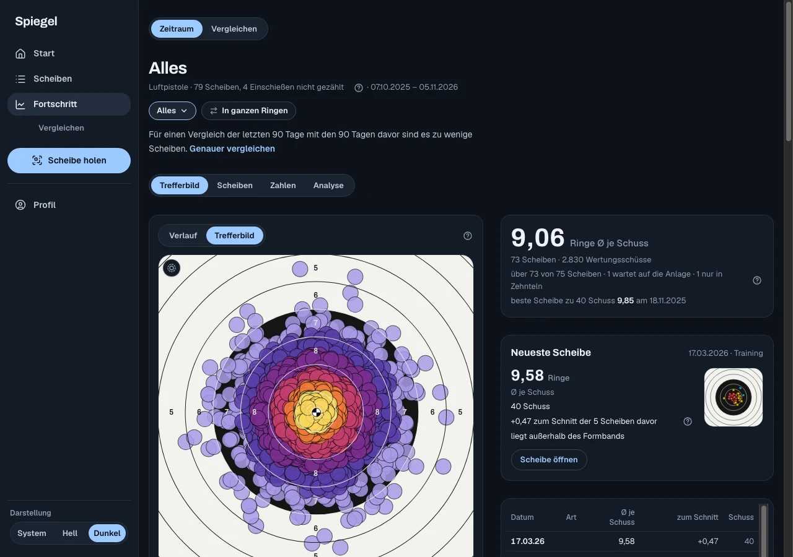</td>
    <td>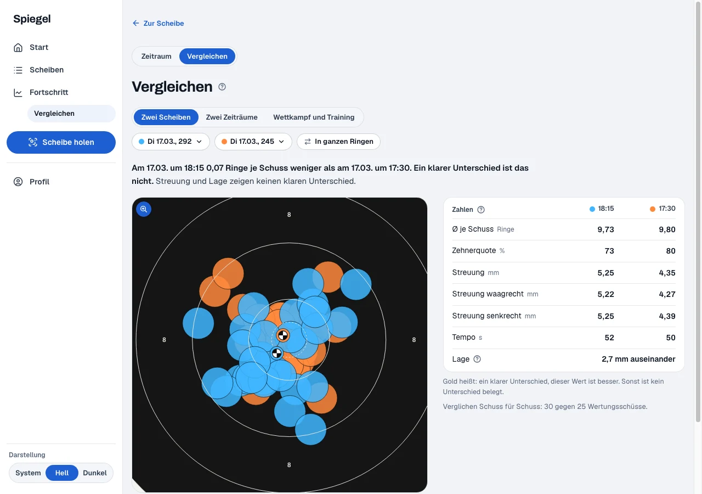</td>
  </tr>
</table>

<p align="center">
  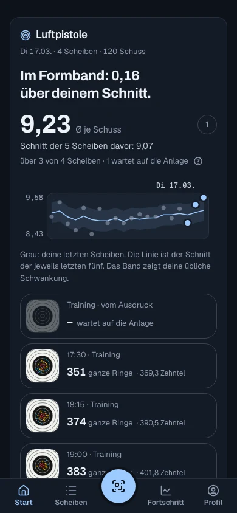
  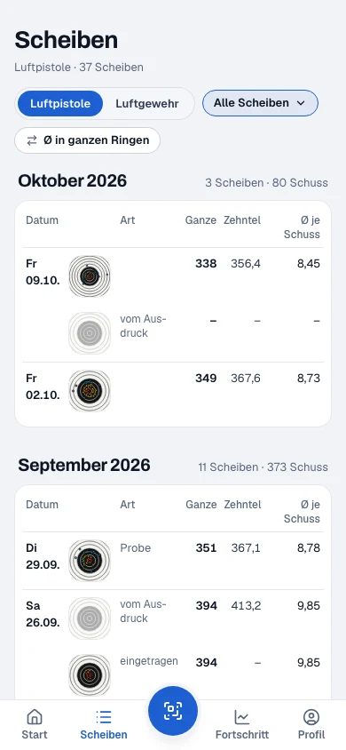
  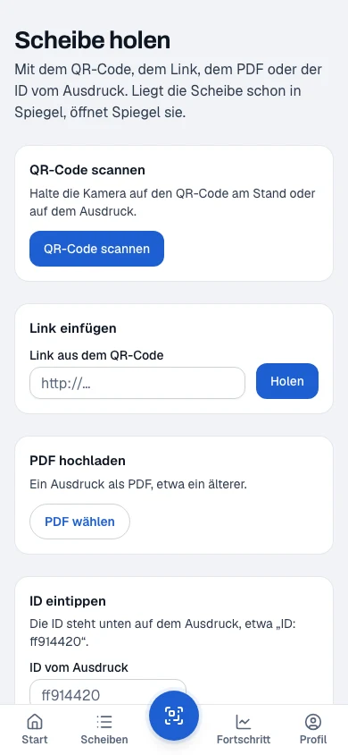
</p>

**Warum nicht die App des Herstellers?** Apps, die Meyton-Daten lesen, gibt es, mit der Analyse im Abo und den Daten
auf einem fremden Server. Spiegel behält jeden Schuss auf dem Server des Vereins, zeigt jede Kennzahl als Verlauf und im
direkten Vergleich, läuft am Desktop wie am Telefon und ordnet Scheiben von selbst zu, sobald ein Schütze zugestimmt hat.
Die eigenen Daten lassen sich jederzeit exportieren.

## Ringwerk

<p align="center">
  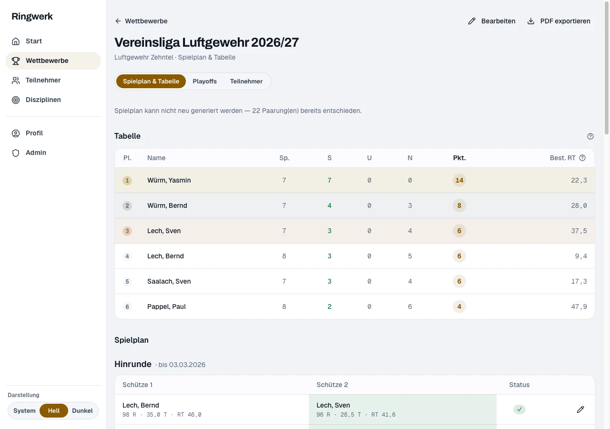
</p>

- **Drei Formate, eine Wertung.** Liga (Spielplan jeder gegen jeden → Tabelle → Playoffs im K.-o.-System), Veranstaltung
  (ein Abend, Rangliste) und Saison (über Monate, beste Einzelserien).
- **8 Wertungsarten** (Ring-Teiler, Ringe, Zielwert, …) mit Korrekturfaktoren je Disziplin für gemischte Disziplinen.
- **Playoff-Bäume** Best-of-N, Finale mit Entscheidungsregeln und Sudden Death.
- Teilnehmer mit Gästen, Rollen (Admin, Verwalter, Betrachter) und vollständigem Protokoll.
- **Öffentliche Ergebnis-PDFs** unter einem festen Link, fertig für die Vereinsseite.

<p align="center">
  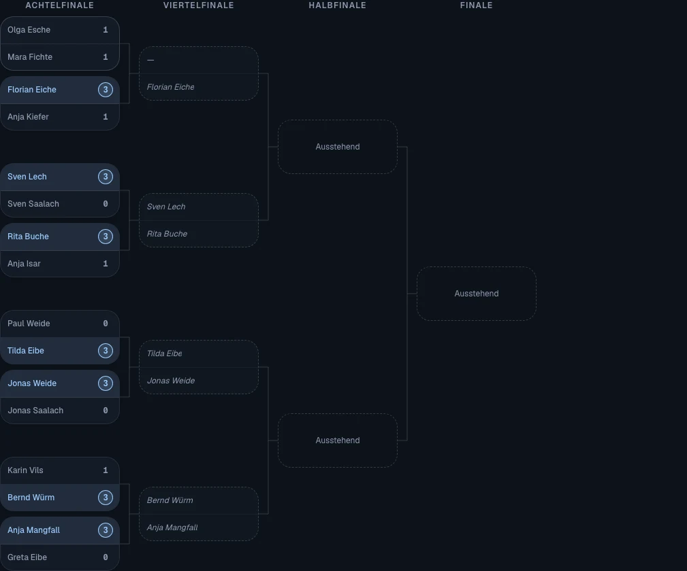
  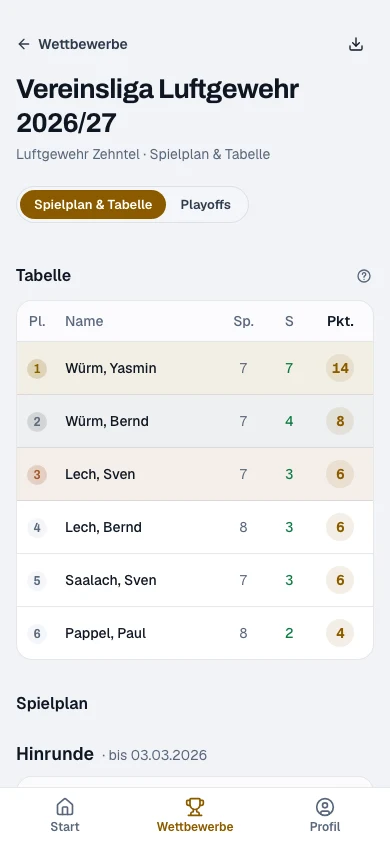
</p>

## Wie es zusammenspielt

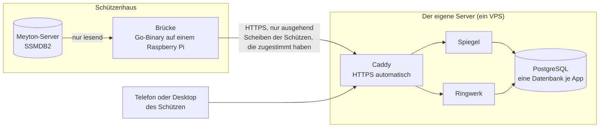

Die **Brücke** ([`apps/spiegel-bridge`](apps/spiegel-bridge)) ist ein einzelnes statisches Go-Binary neben dem
Meyton-Server. Sie liest nur, verbindet sich nur ausgehend, hält außer ihrer Konfiguration nichts auf der Platte, lädt
nur Scheiben von Schützen hoch, die zugestimmt haben, nie eine verdeckte Wertung, und übersteht es, nach jedem
Trainingsabend hart ausgeschaltet zu werden.

**Datenschutz.** Spiegel speichert eine Scheibe nur, wenn sie einem Schützen gehört, der mit seiner Sportpassnummer
zugestimmt hat, oder wenn ein Schütze sie über ihren QR-Code geholt hat. Jeder Lesezugriff ist auf den angemeldeten
Schützen gefiltert, auch für Admins. Schützen können eine einzelne Scheibe per Link teilen, alles als JSON exportieren
und ihr Konto selbst löschen.

## Ausprobieren

Braucht Node ≥ 26 (siehe `.nvmrc`), pnpm, Go ≥ 1.24 und Docker.

```bash
git clone https://github.com/cykedev/vereinsheim.git
cd vereinsheim
./scripts/vereinsheim dev-setup     # Toolchain, Dev-Postgres, .env-Dateien, Schema; idempotent
pnpm dev                            # Ringwerk :3000, Spiegel :3002
```

`dev-setup` startet den geteilten Dev-Postgres aus `docker-compose.dev.yml` und legt die `.env` jeder App aus ihrer
`.env.example` an. Jede App legt beim ersten Start ihr erstes Admin-Konto aus E-Mail und Passwort in der `.env` an.
Spiegel ohne Anlage: `pnpm --filter spiegel seed:own --demo` füllt ein Demo-Konto mit erfundenen Scheiben.

Das Gate prüft Lint, Formatierung, Tests, Typen und Build für jedes Paket:

```bash
pnpm check
```

Zu den Apps: [Spiegel](apps/spiegel/README.md) · [Spiegel-Brücke](apps/spiegel-bridge/README.md) ·
[Ringwerk](apps/ringwerk/README.md)

## Für den eigenen Verein betreiben

Die Images entstehen lokal aus dem Monorepo (`turbo prune`, ein parametrisiertes `Dockerfile`), gehen zu Docker Hub
und der Server zieht sie. `compose.yml` startet Caddy (HTTPS automatisch), einen Postgres mit einer Datenbank und
einem Owner je App und je App einen Migrator vor dem App-Container. Ein VPS mit 2 GB reicht.

```bash
./scripts/vereinsheim local-setup   # einmal: VPS-Host, Pfad des Repos, Docker-Hub-Nutzer
./scripts/vereinsheim release       # alle Apps bauen und hochladen, dann auf dem VPS ausrollen
./scripts/vereinsheim help          # alles Weitere: Backup, Restore, Rollback, Logs, psql, …
```

Einrichtung des Servers, `.env`, Deploy, Backups und Wiederherstellung:
[vault/operations/operations.md](vault/operations/operations.md). Die Brücke im Schützenhaus einrichten:
[apps/spiegel-bridge/README.md](apps/spiegel-bridge/README.md).

## Unter der Haube

| Schicht   | Technik                                                |
| --------- | ------------------------------------------------------ |
| Framework | Next.js 16 (App Router), React 19                      |
| Sprache   | TypeScript (strict); Go für die Brücke                 |
| Datenbank | PostgreSQL 15 + Prisma 7                               |
| Anmeldung | NextAuth.js v4                                         |
| UI        | shadcn/ui + Tailwind CSS 4 · SVG-Diagramme (shot-ui)   |
| Werkzeuge | pnpm + Turborepo · Vitest                              |
| Betrieb   | Docker · Caddy · ein VPS · Ops-CLI `vereinsheim`       |

```
apps/
  spiegel/           Schussrohdaten aus Meyton
  spiegel-bridge/    die Brücke im Schützenhaus (Go)
  ringwerk/          Liga & Wettkämpfe
packages/
  shot-core          Wertung wie Meyton, Geometrie der Scheibe, Kennzahlen, Projektion je Scheibe
  shot-ui            die React-Bausteine von Spiegel
  shot-help          Hilfe in einfacher Sprache zu jeder Kennzahl
  ingest-contract    Vertrag Brücke ↔ Spiegel (Snapshot v1, Prüfsumme, Testvektoren)
  ssmdb2-cases       Sonderfälle als Testdaten, die Meytons Datenbank nachspielen
  meyton-pdf         liest ID und Erstellzeit aus Meyton-Ausdrucken
  pruefen            Skriptprüfung im Browser ohne Fenster, auch die Bilder der README
  config, lib, ui    geteilte Tooling-Konfiguration, Utilities, UI-Primitives (Design 2)
scripts/             das Ops-CLI und die Skripte, die es aufruft
tools/stack-e2e/     der ganze Stack Ende zu Ende mit den echten Images
vault/               Doku: Spezifikationen, ADRs, Betrieb (ein Obsidian-Vault)
docs/screenshots/    die Bilder oben, neu erzeugt mit `pnpm --filter <app> readme-bilder`
```

Die Wertung rechnet wie Meyton: dieselbe Toleranz von 10 µm an jeder Ringgrenze, geprüft gegen zwei Jahre Geschichte
einer Anlage, 43.000 Schuss, keine Abweichung. Die Sonderfälle der Meyton-Datenbank (Probeschüsse, die verschwinden,
Korrekturen, halb gelesene Zeilen, Uhren je Stand, die auseinanderlaufen) sind als nachspielbare Testfälle eingefroren.

### Gebaut mit einem Agent-Harness

Das Repo bringt einen Harness für [Claude Code](https://claude.com/claude-code) mit: Doku als ADRs im `vault/`, über MCP
als Wissensgraph abfragbar, Hooks (Gate am Ende jedes Turns, Schutz der kritischen Pfade in autonomen Läufen),
wiederverwendbare Skills und ein Ablauf plan → implement → validate → review mit autonomer Umsetzung. Siehe
[CLAUDE.md](CLAUDE.md) und [vault/decisions](vault/decisions/decisions.md).

## Mitmachen

Issues und Pull Requests sind willkommen, auf Deutsch oder Englisch. Die Oberfläche der Apps ist **deutsch** (ihre Nutzer
sind deutschsprachige Schützenvereine); Code, Bezeichner und Commit-Messages sind englisch, die Doku im `vault/` deutsch.
Siehe [CONTRIBUTING.md](CONTRIBUTING.md).

## Lizenz

[Apache-2.0](LICENSE).

## Geschichte

**Treffsicher**, das frühere Trainingstagebuch, ist im Ruhestand: Seine Daten sind ins Tagebuch von Spiegel gezogen, sein
Code hat das Repo verlassen (letzter Stand am Tag `treffsicher-final`).
