<p align="center"><a href="README.de.md">Deutsch</a> · <strong>English</strong></p>

<p align="center">
  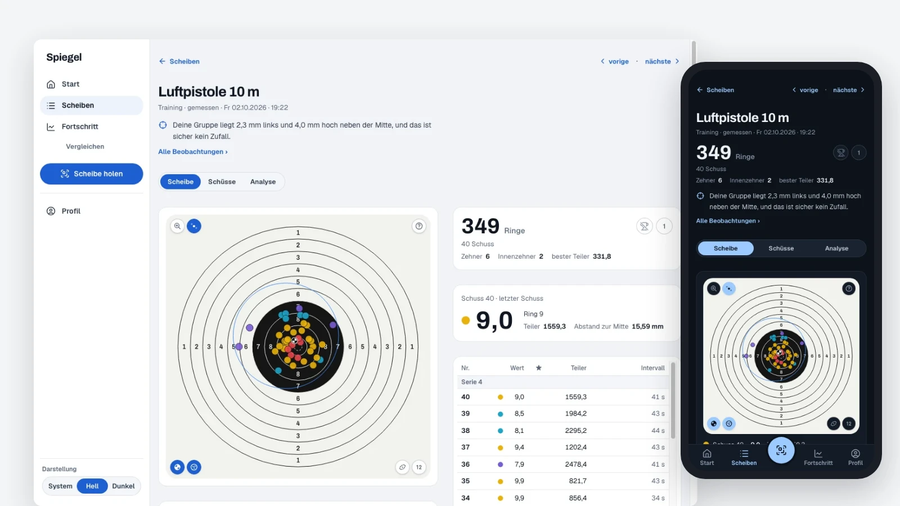
</p>

<h1 align="center">vereinsheim</h1>

<p align="center"><strong>Every shot, exactly as it landed.</strong><br>
Open-source, self-hosted software for sport-shooting clubs.</p>

<p align="center">
  
  
  
  
  
</p>

**Spiegel** (German for *mirror*) takes the raw data your club's Meyton electronic targets already record, position to
1/100 mm, ring, tenth, divisor, time to the millisecond, and shows it to the shooter who fired it: on the phone on the
way home, on the desktop for a closer look. **Ringwerk** runs the club's leagues and competitions. Both run side by side
on one small server. Your members' data never leaves it.

---

## Spiegel

<p align="center">
  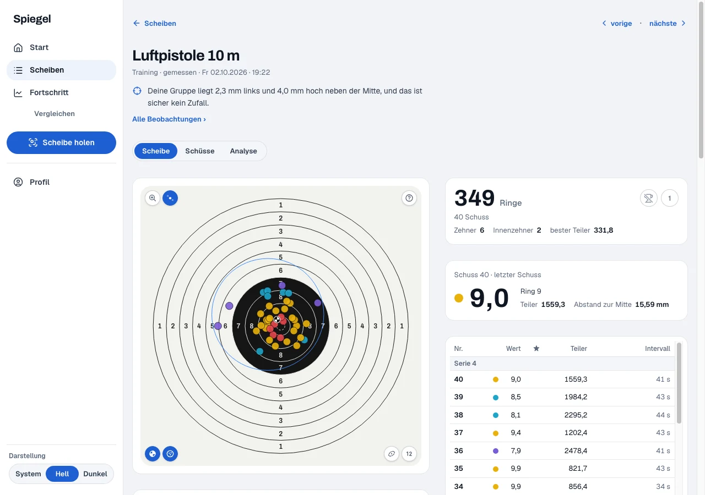
</p>

- **One card, every shot.** The target with all shots, series, the shot table with position, ring, tenth, divisor and
  time, official and tenth scoring side by side.
- **Analysis in six tabs.** Position, spread, timing, trend and more, every metric with help in plain language. Spiegel
  says "unclear" where the data does not carry a conclusion.
- **Progress over weeks.** Trend, volume, a training calendar, comparison against any period, personal records.
- **Compare.** Two periods, training against competition, or two cards shot for shot.
- **Fetch a card.** Scan the QR code on the Meyton printout, drop in the PDF, or type the ID: the card is yours.
- **Private by default.** A card is assigned to a shooter only after they opt in with their sports-pass number. Admins
  manage accounts and never see other people's shots. Hidden scoring modes never leave the range.
- **Diary.** Sessions, goals with a measurable criterion, routines, and an analysis of what influences your form.

<table>
  <tr>
    <td>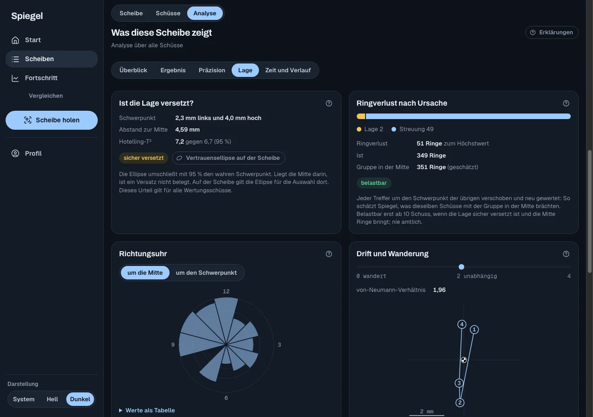</td>
    <td>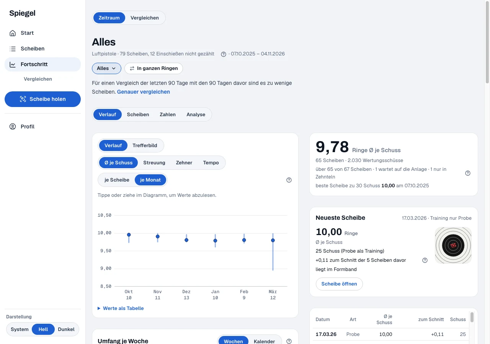</td>
  </tr>
  <tr>
    <td>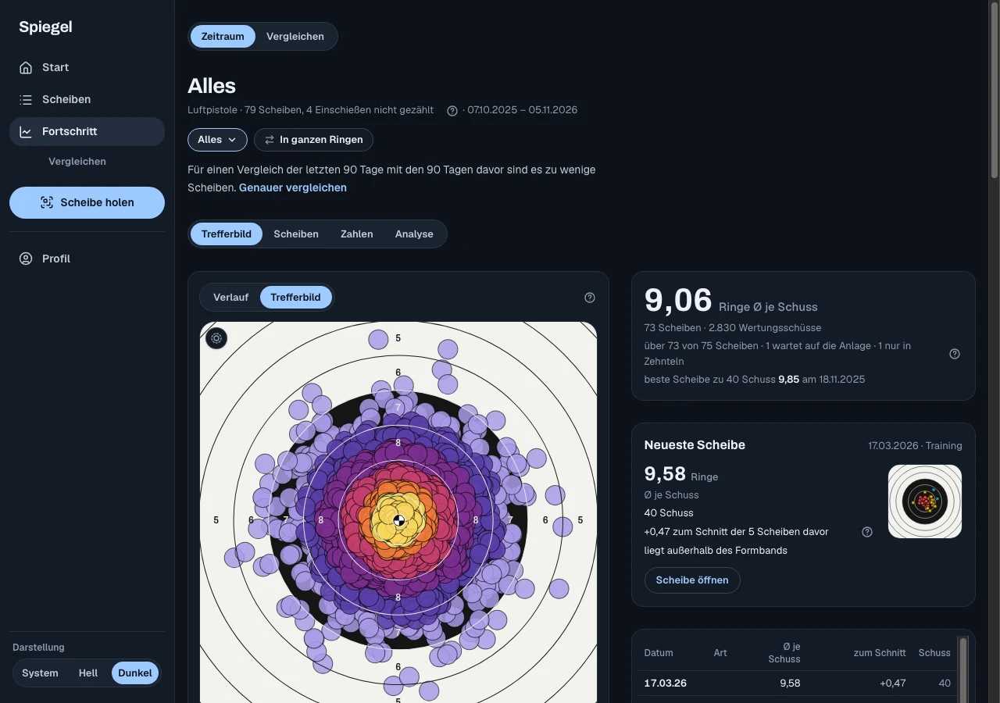</td>
    <td>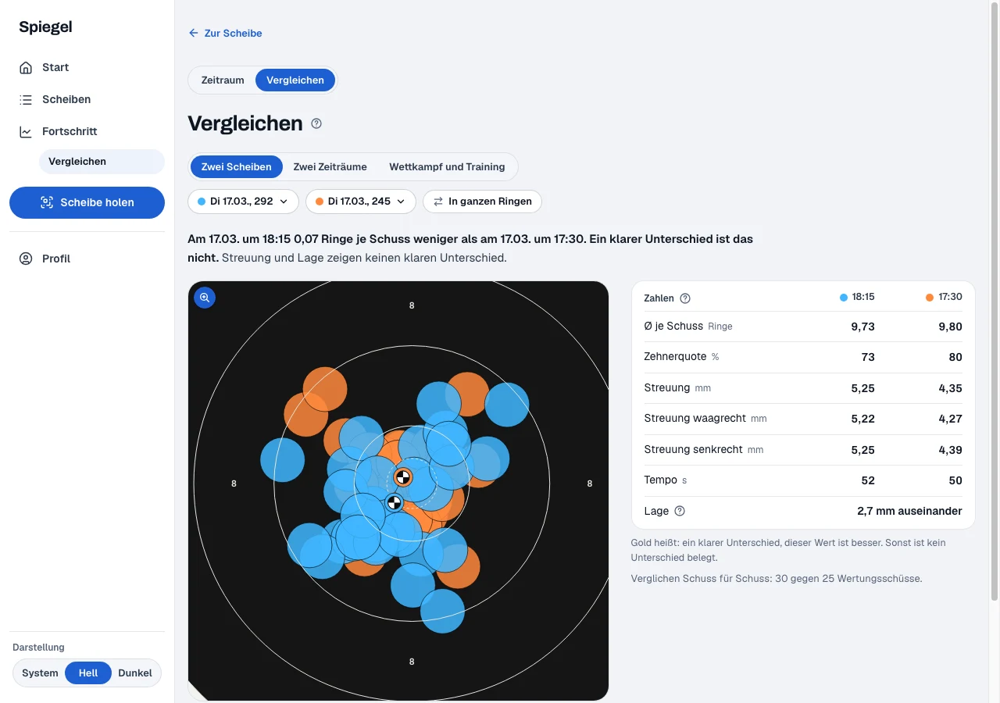</td>
  </tr>
</table>

<p align="center">
  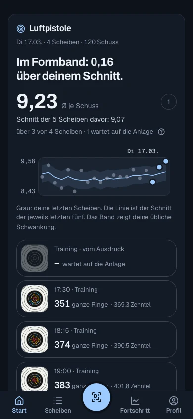
  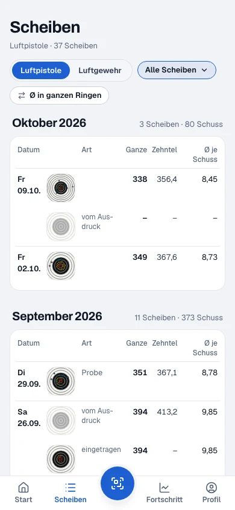
  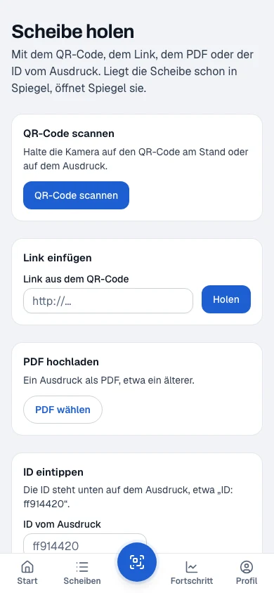
</p>

**Why not the vendor's app?** Apps that read Meyton data exist, with the analysis behind a subscription and the data on
someone else's server. Spiegel keeps every shot on the club's own server, shows every metric as a trend and in direct
comparison, works on desktop as well as on the phone, and assigns cards automatically once a shooter has opted in. Export
your data any time.

## Ringwerk

<p align="center">
  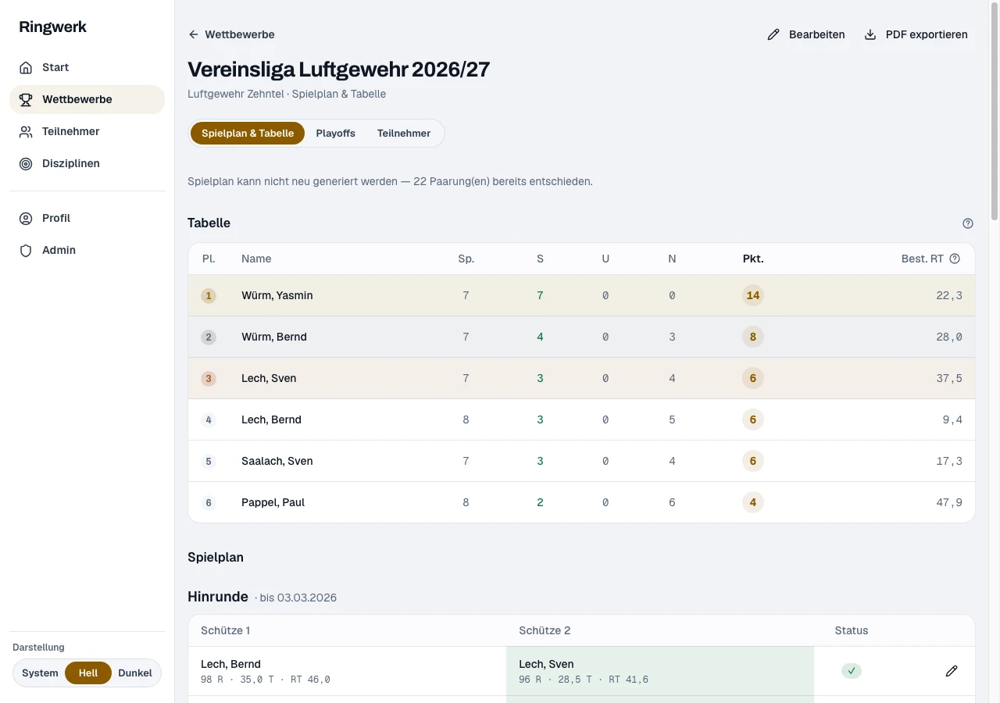
</p>

- **Three formats, one scoring engine.** League (round-robin schedule → standings → knockout playoffs), event (one-off
  shoots, ranked) and season (months-long, best individual series).
- **8 scoring modes** (ring-divisor, rings, target value, …) with per-discipline correction factors for mixed
  disciplines.
- **Playoff brackets** best-of-N, finals with tiebreakers and sudden death.
- Participants with guests, roles (admin, manager, viewer) and a full audit log.
- **Public result PDFs** at a stable link, ready for the club website.

<p align="center">
  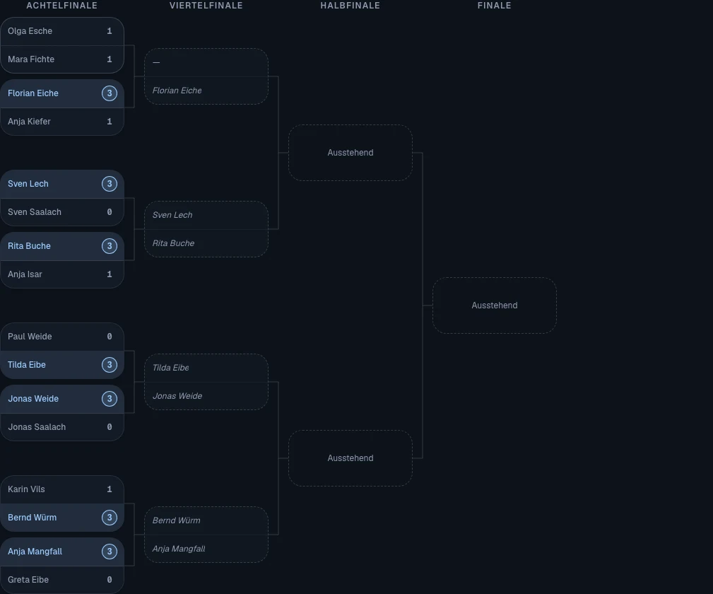
  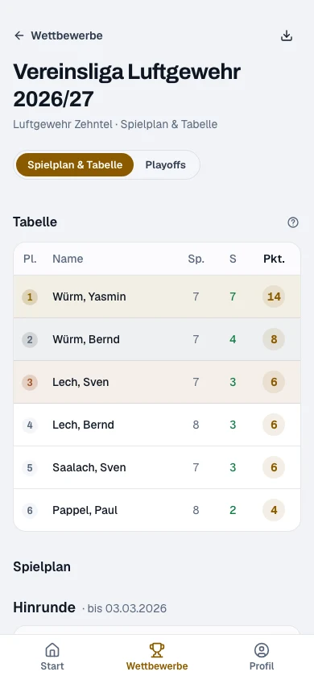
</p>

## How it fits together

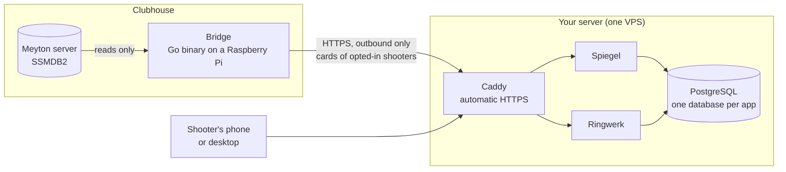

The **bridge** ([`apps/spiegel-bridge`](apps/spiegel-bridge)) is a single static Go binary next to the Meyton server. It
only reads, only connects outbound, keeps nothing but its config on disk, uploads only cards of shooters who opted in,
never a hidden scoring, and survives being switched off hard after every training night.

**Privacy.** Spiegel stores a card only when it belongs to a shooter who has opted in with their sports-pass number, or
when a shooter fetched it by its QR code. Every read is filtered by the signed-in shooter, also for admins. Shooters can
share a single card by link, export everything as JSON and delete their account themselves.

## Try it

Requires Node ≥ 26 (see `.nvmrc`), pnpm, Go ≥ 1.24 and Docker.

```bash
git clone https://github.com/cykedev/vereinsheim.git
cd vereinsheim
./scripts/vereinsheim dev-setup     # toolchain, dev Postgres, .env files, schema; idempotent
pnpm dev                            # Ringwerk :3000, Spiegel :3002
```

`dev-setup` starts the shared dev Postgres from `docker-compose.dev.yml` and creates each app's `.env` from its
`.env.example`. Each app creates its first admin account on first start from the admin email and password in its `.env`.
Spiegel without a range: `pnpm --filter spiegel seed:own --demo` fills a demo account with invented cards.

The quality gate runs lint, format check, tests, type check and build for every package:

```bash
pnpm check
```

App details: [Spiegel](apps/spiegel/README.md) · [Spiegel bridge](apps/spiegel-bridge/README.md) ·
[Ringwerk](apps/ringwerk/README.md)

## Run it for your club

Images are built locally from the monorepo (`turbo prune`, one parameterized `Dockerfile`), pushed to Docker Hub and
pulled by the server. `compose.yml` runs Caddy (automatic HTTPS), one Postgres with one database and owner per app,
and per app a one-shot migrator before the app container. A 2 GB VPS is enough.

```bash
./scripts/vereinsheim local-setup   # once: VPS host, repo path, Docker Hub user
./scripts/vereinsheim release       # build + push all apps, then deploy on the VPS
./scripts/vereinsheim help          # everything else: backup, restore, rollback, logs, psql, …
```

Server setup, `.env`, deploy, backups and recovery: [vault/operations/operations.md](vault/operations/operations.md).
Installing the bridge at the range: [apps/spiegel-bridge/README.md](apps/spiegel-bridge/README.md).

## Under the hood

| Layer     | Tech                                                  |
| --------- | ----------------------------------------------------- |
| Framework | Next.js 16 (App Router), React 19                     |
| Language  | TypeScript (strict); Go for the bridge                |
| Database  | PostgreSQL 15 + Prisma 7                              |
| Auth      | NextAuth.js v4                                        |
| UI        | shadcn/ui + Tailwind CSS 4 · SVG charts (shot-ui)     |
| Tooling   | pnpm + Turborepo · Vitest                             |
| Deploy    | Docker · Caddy · single VPS · ops CLI `vereinsheim`   |

```
apps/
  spiegel/           Meyton shot data
  spiegel-bridge/    bridge at the range (Go)
  ringwerk/          leagues & competitions
packages/
  shot-core          scoring like Meyton, target geometry, metrics, projection per card
  shot-ui            Spiegel's React building blocks
  shot-help          plain-language help for every metric
  ingest-contract    bridge ↔ Spiegel contract (snapshot v1, checksum, test vectors)
  ssmdb2-cases       edge-case test data replaying Meyton's database
  meyton-pdf         reads ID and creation time from Meyton printouts
  pruefen            scripted checks in headless Chrome, also the README screenshots
  config, lib, ui    shared tooling config, utilities, UI primitives (Design 2)
scripts/             ops CLI and the scripts it wraps
tools/stack-e2e/     the whole stack end to end with the real images
vault/               documentation: specs, ADRs, operations (an Obsidian vault)
docs/screenshots/    the pictures above, regenerated by `pnpm --filter <app> readme-bilder`
```

Scoring reproduces Meyton's: the same 10 µm tolerance at every ring boundary, verified against two years of one
range's history, 43,000 shots, zero deviations. Edge cases of the Meyton database (probe shots vanishing, corrections,
torn reads, clock drift per lane) are frozen as replayable test cases.

### Built with an agent harness

The repo carries a harness for [Claude Code](https://claude.com/claude-code): ADR-driven docs in `vault/` served as a
knowledge graph over MCP, hooks (quality gate at the end of every turn, protected-path guard for autonomous runs),
reusable skills and a plan → implement → validate → review workflow with autonomous implementation. See
[CLAUDE.md](CLAUDE.md) and [vault/decisions](vault/decisions/decisions.md).

## Contributing

Issues and pull requests are welcome, in German or English. The apps' UI is in **German** (their users are
German-speaking shooting clubs); code, identifiers and commit messages are in English, docs in `vault/` are German.
[CONTRIBUTING.md](CONTRIBUTING.md) is in German; this section is its short version.

## License

[Apache-2.0](LICENSE).

## History

**Treffsicher**, the former training log, is retired: its data moved into Spiegel's diary, and its code left the repo
(last state at the tag `treffsicher-final`).
