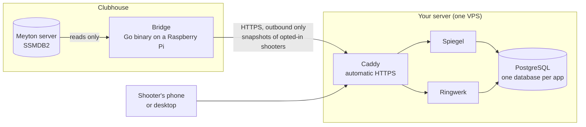

# GitHub-Auftritt: README mit Bildern, Repo-Metadaten, Vorlagen, erstes Release

**Branch:** `feat/github-auftritt` · **Datum:** 4. November 2026 · **Status:** offen

## Context

Die Seite [github.com/cykedev/vereinsheim](https://github.com/cykedev/vereinsheim) soll Aufmerksamkeit erregen,
Spiegel zuerst. Heute verkauft sie das falsche Produkt: Die Beschreibung (und damit der Tab-Titel) nennt Ringwerk und
das tote Treffsicher, nicht Spiegel. Die README hat kein Bild und kein Diagramm, führt mit Ringwerk und nennt
Treffsicher dreimal. Es gibt kein Release (nur den Tag `treffsicher-final`), keinen `.github/`-Ordner, kein
Social-Preview-Bild, das Wiki ist an und leer, Discussions sind aus. Die 20 Topics enthalten `training-log` und
Generisches (`react`, `docker-compose`, `tailwindcss`), aber nicht `meyton`, `electronic-target`, `shot-analysis`,
`raspberry-pi`, `go`.

Zwei Leser: der Sportleiter (Deutsch, will Bilder) und der Entwickler (Englisch, will Ernsthaftigkeit sehen). Beide
entscheiden am ersten Bildschirm.

**Konzept (freigegeben am 4. November 2026):** Hero mit Spiegel und einem Bild, Screenshots reproduzierbar per
Werkzeug aus erfundenen Daten (ADR-029: nie echte Namen, Sportpassnummern oder Schüsse von Personen), Mermaid-Diagramm
des Datenflusses, README neu gegliedert, Social-Preview-Bild, Issue-Vorlagen, CONTRIBUTING und SECURITY, Beschreibung
und Topics neu, erstes Release. Weggelassen (eigene Vorhaben): CI-Badge (ADR-006 offen), One-Command-Demo mit
`compose.local.yml`, Homepage-Feld, Tagebuch-Screenshot (`seed:own --demo` legt keine Einträge an), animierte Bilder
(es gibt keine Wiedergabe der Schüsse).

## Approach

**Bilder kommen aus einem Werkzeug je App**, nicht aus Handfotos, damit sie nach jedem Design-Umbau mit einem Befehl
neu entstehen:

- Spiegel: `apps/spiegel/tools/readme-bilder.ts` startet den gebauten Stand auf :3012 (wie `pruefen --start`, kein
  Dev-Badge von Next im Bild), meldet das Demo-Konto an (`seed:own --demo`: 72 erfundene LP-Scheiben, `demo@example.com`)
  und fotografiert feste Adressen hell und dunkel, 1280 und 390 px. Das Demo-Konto ist kein Admin und sieht nur seine
  erfundenen Scheiben, auch auf der Prod-Kopie der Dev-Datenbank. Danach rendert dasselbe Werkzeug zwei HTML-Vorlagen
  aus `apps/spiegel/tools/readme-bilder/` über `file://` zu Verbundbildern: `hero.webp` (Desktop hell neben Telefon
  dunkel) und `social-preview.png` (1280×640 für die Repo-Einstellungen).
- Ringwerk: `apps/ringwerk/tools/readme-bilder.ts` startet den gebauten Stand auf :3013 gegen die Prüfdatenbank
  `ringwerk_pruef` (`pruefdaten`: erfundene Namen aus `names.ts`), meldet `pruef-admin@example.test` an und fotografiert
  Tabelle, Bracket und Spielplan, dazu die erste Seite des öffentlichen PDFs über Poppler. Der Prüfbestand nennt
  Wettbewerbe nach ihrem Fall („L-DRR-6 · L3 Rückrunde läuft (Hin/Rück)“); für das Bild setzt das Werkzeug die
  Überschrift `main h1` im DOM auf „Vereinsliga Luftpistole 2026/27“. Das ist ein Etikett auf erfundenen Daten und steht
  so im Kommentar des Werkzeugs.
- WebP direkt aus Chrome (`Page.captureScreenshot` mit `format: "webp"`), keine neue Abhängigkeit: `Page.screenshot`
  und `screenshotOf` in `@vereinsheim/pruefen` bekommen ein Format. Ein Bild 1280×900 liegt dann bei 60 bis 120 KB statt
  300 bis 500 KB.
- Ablage der Bilder unter `docs/screenshots/` (versioniert, die README verweist relativ darauf). Kein Gate prüft
  `docs/`; Prettier läuft nur in Apps und Paketen.

**README** wird neu geschrieben (vollständiger Text unten in Task 5): Hero, Spiegel, Ringwerk, Datenfluss als Mermaid
(GitHub rendert es nativ, hell und dunkel), Datenschutz, Ausprobieren, Betreiben, Unter der Haube, Agent-Harness,
Contributing, Lizenz, Geschichte (Treffsicher in einem Satz). Deutscher Dreizeiler oben statt des Abschnitts am Ende.

**Repo-Metadaten, Social Preview und Release** sind öffentlich wirksam und bleiben user-gated: Sie stehen als Befehle im
Abschnitt „Nach dem Merge“ und laufen erst nach dem Merge auf `main` mit Zustimmung des Users. Das Social-Preview-Bild
lädt nur der User in den Einstellungen hoch.

**Doku:** eine Note `vault/operations/github-auftritt.md` (type `operation`) beschreibt das Nachziehen der Bilder,
Topics, Social Preview und Release; verlinkt aus dem MOC `operations` und `vault/index.md`.

## Files

| Datei | Änderung |
| --- | --- |
| `packages/pruefen/src/browser.ts` | `screenshot(fullPage, format, quality)`, `screenshotOf(locator, format, quality)`, `tallShot` nimmt das Format |
| `packages/pruefen/CLAUDE.md` | Tabelle „Exporte“: das Format erwähnen |
| `apps/spiegel/tools/readme-bilder.ts` | neu: Bilder von Spiegel, Hero und Social Preview |
| `apps/spiegel/tools/readme-bilder/hero.html`, `social.html` | neu: Vorlagen der Verbundbilder |
| `apps/spiegel/package.json` | Script `readme-bilder` |
| `apps/spiegel/CLAUDE.md` | Tabelle „Befehle“: `readme-bilder` |
| `apps/ringwerk/tools/readme-bilder.ts` | neu: Bilder von Ringwerk und PDF-Seite |
| `apps/ringwerk/package.json` | Script `readme-bilder` |
| `apps/ringwerk/CLAUDE.md` | Befehl `readme-bilder` |
| `docs/screenshots/*.webp`, `docs/screenshots/ringwerk-pdf-1.png`, `docs/social-preview.png` | neu: die Bilder |
| `README.md` | neu geschrieben |
| `.github/ISSUE_TEMPLATE/fehler.yml`, `vorschlag.yml`, `config.yml`, `.github/PULL_REQUEST_TEMPLATE.md` | neu |
| `CONTRIBUTING.md`, `SECURITY.md` | neu |
| `vault/operations/github-auftritt.md` | neu; `vault/operations/operations.md` und `vault/index.md` verlinken sie |

## Required Docs

- `vault/conventions.md` §9 (Skriptprüfung: erster Lauf nach Serverstart kann abbrechen, einmal wiederholen; parallele
  Sessions und `seed:own`) und §10 (Design 2)
- `packages/pruefen/CLAUDE.md` (Browser-API, Fotos über das Fenster hinaus, nie `captureBeyondViewport`)
- `apps/spiegel/CLAUDE.md` „Skriptprüfung der App“ und „seed:own“; `apps/spiegel/tools/pruefen.ts` (`login`, `pickCard`,
  `--start`, `UPLOAD_DIR`)
- `apps/ringwerk/tools/pruefen.ts` (`signIn`, `competitionIds`, `config` für `.env`, `PHASES`) und
  `apps/ringwerk/tools/pruefen-bilder.ts` (`pictures`: Theme über `localStorage`, Bracket-Locator)
- `vault/decisions/adr-029.md` (nur erfundene oder eigene Daten im Repo)
- `vault/SCHEMA.md` §3 (Frontmatter der neuen Note)

## Tasks

### Task 1 — WebP aus Chrome (`packages/pruefen`)

`packages/pruefen/src/browser.ts`:

```ts
export type ShotFormat = "png" | "webp"

  /**
   * Bildschirmfoto des Fensters; `fullPage`: die ganze Seite, höchstens `MAX_SHOT_HEIGHT` hoch. WebP mit `quality`
   * (0 bis 100) für Bilder im Repository, PNG für Vergleiche Pixel für Pixel.
   */
  async screenshot(fullPage = false, format: ShotFormat = "png", quality = 85): Promise<Buffer> {
    if (!fullPage) {
      const { data } = await this.send<{ data: string }>("Page.captureScreenshot", shotParams(format, quality))
      return Buffer.from(data, "base64")
    }
    const height = await this.ev<number>(
      "Math.max(document.documentElement.scrollHeight, document.body?.scrollHeight ?? 0)"
    )
    return this.tallShot(Math.ceil(height), undefined, format, quality)
  }
```

`tallShot(height, clip?, format = "png", quality = 85)` ruft `Page.captureScreenshot` mit
`{ ...shotParams(format, quality), ...(clip ? { clip } : {}) }`; `screenshotOf(locator, format = "png", quality = 85)`
reicht beide weiter. Helfer oben in der Datei:

```ts
/** Parameter für `Page.captureScreenshot`: PNG ohne, WebP mit Qualität */
const shotParams = (format: ShotFormat, quality: number) =>
  format === "png" ? { format } : { format, quality }
```

`packages/pruefen/CLAUDE.md`, Zeile zu `browser.ts`: „Foto eines Elements `screenshotOf`“ → „Fotos `screenshot` und
`screenshotOf`, PNG oder WebP mit Qualität“.

Test: `pnpm --filter @vereinsheim/pruefen check-types`; die Aufrufer (`pruefen.ts` beider Apps, `pruefen-bilder.ts`,
`capture.ts`) kompilieren unverändert (Defaults).

### Task 2 — Spiegel: `readme-bilder.ts` mit den Seiten

`apps/spiegel/package.json`, Scripts: `"readme-bilder": "tsx tools/readme-bilder.ts"`.

`apps/spiegel/tools/readme-bilder.ts` (Kopf wie `pruefen.ts`: `process.stdout.write`, `main().catch`, CommonJS):

```ts
// Bilder für die README aus erfunden Daten (ADR-029): der gebaute Stand dieses Checkouts auf :3012, angemeldet mit
// dem Demo-Konto (`seed:own --demo`), hell und dunkel, 1280 und 390 px, als WebP nach `docs/screenshots/`. Danach die
// Verbundbilder aus den Vorlagen in `readme-bilder/`: `hero.webp` (Desktop neben Telefon) und `docs/social-preview.png`
// (1280×640, in den Einstellungen des Repositories hochzuladen). Nicht im Gate.
//
//   pnpm --filter spiegel seed:own --demo      einmal: die Scheiben dem Demo-Konto
//   pnpm --filter spiegel build                der Stand, der fotografiert wird
//   pnpm --filter spiegel readme-bilder        schreibt docs/screenshots/spiegel-*.webp, hero.webp, docs/social-preview.png
```

Konstanten und Ablauf:

```ts
const PORT = 3012
const BASE = `http://localhost:${PORT}`
const ROOT = resolve(__dirname, "../../..")
const OUT = join(ROOT, "docs", "screenshots")
const THEME_KEY = "spiegel-theme"

interface Shot {
  /** Dateiname ohne Endung, `spiegel-…` */
  name: string
  path: string
  width: 1280 | 390
  theme: "light" | "dark"
}
const PHONE = [390, 844] as const
const DESKTOP = [1280, 900] as const
```

Liste `shots(card: string)` (die Adresse der Scheibe aus `pickCard`, kopiert aus `pruefen.ts`: mindestens 30
Wertungsschüsse, Vorige und Nächste, Reiter „Lage“, keine Probe im Kopf):

| name | path | width | theme |
| --- | --- | --- | --- |
| `spiegel-start` | `/` | 1280 | light |
| `spiegel-start-phone` | `/` | 390 | dark |
| `spiegel-card` | `${card}` | 1280 | light |
| `spiegel-card-phone` | `${card}` | 390 | dark |
| `spiegel-card-analysis` | `${card}#position` | 1280 | dark |
| `spiegel-cards-phone` | `/cards` | 390 | light |
| `spiegel-progress` | `/progress?range=all` | 1280 | light |
| `spiegel-progress-target` | `/progress?range=all&show=target` | 1280 | dark |
| `spiegel-compare` | `/compare` | 1280 | light |
| `spiegel-scan-phone` | `/scan` | 390 | light |

Aufnahme je Eintrag (Theme wie in `pruefen-bilder.ts` über `localStorage` auf einer geladenen Seite, dann die Adresse):

```ts
async function take(page: Page, shot: Shot) {
  const [w, h] = shot.width === 390 ? PHONE : DESKTOP
  await page.viewport(w, h)
  await page.goto(`${BASE}/profile`)
  await page.ev(`localStorage.setItem(${JSON.stringify(THEME_KEY)}, ${JSON.stringify(shot.theme)})`)
  await page.goto(`${BASE}${shot.path}`, '$("[data-app-content]")')
  await page.wait(800)
  await writeFile(join(OUT, `${shot.name}.webp`), await page.screenshot(false, "webp", 88))
}
```

`main()`: Zeitgrenze 300 s wie `pruefen.ts`; `UPLOAD_DIR` als `mkdtemp` wie dort; `startServer({ app: "spiegel",
port: PORT, out })`; `Browser.launch()`; `login(page)` (kopiert aus `pruefen.ts`, mit `DEMO_EMAIL`/`DEMO_PASSWORD`);
`mkdir(OUT, { recursive: true })`; `pickCard`; alle `shots` nacheinander; am Ende
`localStorage.removeItem(THEME_KEY)`, Browser und Server schließen (`server.kill()` wie in `pruefen.ts`), Ausgabe je
Datei mit Größe in KB.

Test: `pnpm --filter spiegel build`, `pnpm --filter spiegel seed:own --demo`, `pnpm --filter spiegel readme-bilder`;
`ls -la docs/screenshots/spiegel-*.webp` zeigt 10 Dateien; jede im Browser-Pane ansehen: kein Dev-Badge, kein echter
Name, Theme stimmt, kein seitliches Scrollen am Telefon. Danach `pnpm --filter spiegel seed:own --email <eigene Adresse>`
nur, wenn vorher eigene Scheiben am eigenen Konto hingen (Memory „Demo seed restore“).

### Task 3 — Spiegel: Hero und Social Preview aus Vorlagen

`apps/spiegel/tools/readme-bilder/hero.html` (1600×900, Fläche aus den Tokens von Design 2 hell: Hintergrund
`#f4f5f7`, Text `#1b1f27`; die Dateien kommen als `file://`-Pfade über `{{desktop}}` und `{{phone}}`):

```html
<!doctype html>
<meta charset="utf-8">
<style>
  html, body { margin: 0; width: 1600px; height: 900px; overflow: hidden; background: #f4f5f7; }
  .desktop { position: absolute; left: 60px; top: 70px; width: 1180px; border-radius: 14px;
    box-shadow: 0 20px 60px rgba(27, 31, 39, .18); overflow: hidden; }
  .desktop img { display: block; width: 100%; }
  .phone { position: absolute; left: 1210px; top: 110px; width: 330px; padding: 14px; border-radius: 44px;
    background: #1b1f27; box-shadow: 0 20px 60px rgba(27, 31, 39, .28); }
  .phone img { display: block; width: 100%; border-radius: 32px; }
</style>
<div class="desktop"></div>
<div class="phone"></div>
```

`apps/spiegel/tools/readme-bilder/social.html` (1280×640, dunkel wie Design 2 dunkel: Hintergrund `#111419`, Text
`#f1f3f7`, Akzent Blau `#4f8cff`; Schrift Archivo ist nicht offline verfügbar, daher `system-ui`, fett, eng):

```html
<!doctype html>
<meta charset="utf-8">
<style>
  html, body { margin: 0; width: 1280px; height: 640px; overflow: hidden; background: #111419; color: #f1f3f7;
    font-family: system-ui, -apple-system, "Segoe UI", sans-serif; }
  .text { position: absolute; left: 72px; top: 150px; width: 560px; }
  h1 { margin: 0; font-size: 72px; line-height: 1; letter-spacing: -.03em; }
  h1 small { display: block; font-size: 26px; font-weight: 500; color: #4f8cff; letter-spacing: 0; margin-bottom: 18px; }
  p { margin: 28px 0 0; font-size: 26px; line-height: 1.35; color: #c3c8d2; }
  .phone { position: absolute; left: 760px; top: 60px; width: 390px; padding: 14px; border-radius: 44px;
    background: #2a2f3a; box-shadow: 0 20px 60px rgba(0, 0, 0, .5); }
  .phone img { display: block; width: 100%; border-radius: 32px; }
</style>
<div class="text">
  <h1><small>Open source · self-hosted</small>vereinsheim</h1>
  <p>Spiegel: every shot from your Meyton targets, on the shooter's phone.<br>Ringwerk: leagues and competitions.</p>
</div>
<div class="phone"></div>
```

In `readme-bilder.ts` nach den Seiten:

```ts
/** eine Vorlage mit den Bildern füllen, über file:// laden und als Bild schreiben */
async function compose(page: Page, template: string, fill: Record<string, string>, size: readonly [number, number],
  file: string, format: ShotFormat) {
  let html = await readFile(join(__dirname, "readme-bilder", template), "utf8")
  for (const [key, value] of Object.entries(fill)) html = html.replaceAll(`{{${key}}}`, pathToFileURL(value).href)
  const tmp = join(uploads, template)
  await writeFile(tmp, html)
  await page.viewport(size[0], size[1])
  await page.goto(pathToFileURL(tmp).href, "document.readyState === 'complete'")
  await page.wait(300)
  await writeFile(file, await page.screenshot(false, format, format === "webp" ? 90 : 85))
}

await compose(page, "hero.html", { desktop: join(OUT, "spiegel-card.webp"), phone: join(OUT, "spiegel-card-phone.webp") },
  [1600, 900], join(OUT, "hero.webp"), "webp")
await compose(page, "social.html", { phone: join(OUT, "spiegel-card-phone.webp") },
  [1280, 640], join(ROOT, "docs", "social-preview.png"), "png")
```

`uploads` ist das `mkdtemp`-Verzeichnis aus `main()` (auch `UPLOAD_DIR` des Servers). Das Telefonbild ist 390×844 und
wird im Social Preview unten durch `overflow: hidden` beschnitten: gewollt, die Scheibe steht oben auf der Seite.

Chrome headless lädt `file://` ohne Schalter; `goto` wartet auf `Page.loadEventFired`, die Helfer im Fenster hängen an
`Page.addScriptToEvaluateOnNewDocument` und sind vom Schema unabhängig. Verweigert Chrome die Bilder im `file://`-Dokument
dennoch, liefert ein kleiner `createServer` aus `node:http` (wie in `pruefen.ts` für den Ausdruck) Vorlage und Bilder
aus `OUT` unter `http://127.0.0.1:<port>/` aus, und `compose` lädt diese Adresse.

Test: `docs/screenshots/hero.webp` 1600×900 und `docs/social-preview.png` 1280×640 im Browser-Pane ansehen (Größe mit
`sips -g pixelWidth -g pixelHeight <datei>`).

### Task 4 — Ringwerk: `readme-bilder.ts`

`apps/ringwerk/package.json`, Scripts:
`"readme-bilder": "tsx --tsconfig tools/pruefdaten/tsconfig.json tools/readme-bilder.ts"`.

`apps/ringwerk/tools/readme-bilder.ts`:

```ts
// Bilder für die README aus dem Prüfbestand (erfundene Namen, ADR-029): der gebaute Stand dieses Checkouts auf :3013
// gegen `ringwerk_pruef`, angemeldet als Admin des Prüfbestands, als WebP nach `docs/screenshots/`, dazu die erste
// Seite des öffentlichen PDFs über Poppler als PNG. Der Prüfbestand nennt Wettbewerbe nach ihrem Fall; für das Bild
// bekommt die Überschrift `main h1` einen Vereinsnamen. Nicht im Gate.
//
//   pnpm --filter ringwerk pruefdaten          Prüfdatenbank (einmal vorher)
//   pnpm --filter ringwerk build               der Stand, der fotografiert wird
//   pnpm --filter ringwerk readme-bilder       schreibt docs/screenshots/ringwerk-*.webp und ringwerk-pdf-1.png
```

Konstanten:

```ts
const PORT = 3013
const BASE = `http://localhost:${PORT}`
const APP_DIR = path.resolve(__dirname, "..")
const OUT = path.resolve(APP_DIR, "../../docs/screenshots")
const THEME_KEY = "ringwerk-theme"
const TITLE = "Vereinsliga Luftpistole 2026/27"
const STANDINGS = "L-DRR-6 · L3 Rückrunde läuft (Hin/Rück)"
const PLAYOFFS = "L-DRR-16 · L5 Achtelfinale mitten in der Runde (Hin/Rück)"
const PUBLIC_PDF = "E · Teams Summe, Teamgröße 3, fertig"
/** der Bracket wie in `pruefen-bilder.ts`: das Element, das quer scrollt und „Halbfinale“ enthält */
const BRACKET = `$$("main div").find((el) => getComputedStyle(el).overflowX === "auto" && /Halbfinale/.test(el.textContent))`
```

Abfrage der Kennungen (eigene Kopie von `competitionIds`, erweitert um das öffentliche PDF):

```ts
async function competitions(url: string, names: string[]) {
  const client = new Client({ connectionString: url })
  await client.connect()
  try {
    const { rows } = await client.query<{ id: string; name: string; slug: string | null; locked: boolean }>(
      `SELECT id, name, "publicSlug" AS slug, "publicPasswordHash" IS NOT NULL AS locked
         FROM "Competition" WHERE name = ANY($1)`,
      [names]
    )
    const byName = new Map(rows.map((r) => [r.name, r]))
    const missing = names.filter((n) => !byName.has(n))
    if (missing.length > 0) throw new Error(`nicht im Prüfbestand: ${missing.join(", ")} (erst pruefdaten)`)
    return byName
  } finally {
    await client.end()
  }
}
```

Bilder (Aufnahme `take` wie in Spiegel, `THEME_KEY` angepasst, fertig ist `$("main")`, danach optional die Überschrift):

| name | path | width | theme | h1 |
| --- | --- | --- | --- | --- |
| `ringwerk-standings` | `/competitions/<STANDINGS>/standings` | 1280 | light | TITLE |
| `ringwerk-schedule-phone` | `/competitions/<STANDINGS>/schedule` | 390 | light | TITLE |
| `ringwerk-playoffs` | `/competitions/<PLAYOFFS>/playoffs` | 1280 | dark | TITLE |
| `ringwerk-competitions` | `/competitions` | 1280 | light | – |

Überschrift setzen vor dem Foto: `await page.ev(\`{ const h = $("main h1"); if (h) h.textContent = ${JSON.stringify(TITLE)} }\`)`.
Dazu vom Playoff-Bild der Bracket allein: `page.screenshotOf(BRACKET, "webp", 88)` → `ringwerk-bracket.webp`.

Öffentliches PDF: `const c = byName.get(PUBLIC_PDF)!`; ohne `slug` Fehler „kein öffentlicher Link im Prüfbestand“;
`fetch(\`${BASE}/api/public/c/${c.slug}/pdf\`, { headers: c.locked ? { authorization: \`Basic ${Buffer.from(\`:${env.PRUEF_PUBLIC_PASSWORD}\`).toString("base64")}\` } : {} })`;
Status ≠ 200 ist ein Fehler; `pdfPages(new Uint8Array(await r.arrayBuffer()), OUT, "ringwerk-pdf")` aus
`@vereinsheim/pruefen/pdf` schreibt `ringwerk-pdf-1.png` (und weitere Seiten, die danach gelöscht werden:
`for (const f of files.slice(1)) await rm(f)`).

`main()`: `.env` wie `pruefen.ts` über `config({ path: path.join(APP_DIR, ".env"), processEnv: env, quiet: true })`,
`pruefDatabaseUrl(env)`, `process.env.DATABASE_URL = url`, `startServer({ app: "ringwerk", port: PORT, hostname: "127.0.0.1", out })`,
`Browser.launch()`, `login(page, BASE, { email: "pruef-admin@example.test", password: env.PRUEF_ADMIN_PASSWORD })`
(`login` aus `./pruefen-ringwerk/capture`), Bilder, `localStorage.removeItem`, schließen.

Test: `pnpm --filter ringwerk pruefdaten` (falls `ringwerk_pruef` fehlt), `pnpm --filter ringwerk build`,
`pnpm --filter ringwerk readme-bilder`; 5 WebP und 1 PNG unter `docs/screenshots/`; ansehen: Überschrift ersetzt,
erfundene Namen, Bracket vollständig.

### Task 5 — README neu

`README.md` vollständig ersetzen durch:

````markdown
<p align="center">
  
</p>

<h1 align="center">vereinsheim</h1>

<p align="center"><strong>Every shot, exactly as it landed.</strong><br>
Open-source, self-hosted software for sport-shooting clubs.</p>

<p align="center">
  
  
  
  
  
</p>

**Spiegel** (German for *mirror*) takes the raw data your club's Meyton electronic targets already record, position to
1/100 mm, ring, tenth, divisor, time to the millisecond, and shows it to the shooter who fired it: on the phone on the
way home, on the desktop for a closer look. **Ringwerk** runs the club's leagues and competitions. Both run side by side
on one small server. Your members' data never leaves it.

> **Für Schützenvereine:** Spiegel zeigt jedem Schützen seine Scheiben aus der Meyton-Anlage, Schuss für Schuss, mit
> Schussbild, Serien, Kennzahlen und Verlauf über Wochen; Ringwerk führt Liga und Wettkämpfe. Beides läuft auf einem
> eigenen Server des Vereins. Die Oberfläche ist deutsch. Einstieg: [Ausprobieren](#try-it) und
> [Betrieb](vault/operations/operations.md).

---

## Spiegel

<p align="center">
  
</p>

- **One card, every shot.** The target with all shots, series, the shot table with position, ring, tenth, divisor and
  time, official and tenth scoring side by side.
- **Analysis in six tabs.** Position, spread, timing, trend and more, every metric with help in plain language. Spiegel
  says „unclear“ where the data does not carry a conclusion.
- **Progress over weeks.** Trend, volume, a training calendar, comparison against any period, personal records.
- **Compare.** Two periods, training against competition, or two cards shot for shot.
- **Fetch a card.** Scan the QR code on the Meyton printout, drop in the PDF, or type the ID: the card is yours.
- **Private by default.** A card is assigned to a shooter only after they opt in with their sports-pass number. Admins
  manage accounts and never see other people's shots. Hidden scoring modes never leave the range.
- **Diary.** Sessions, goals with a measurable criterion, routines, and an analysis of what influences your form.

<table>
  <tr>
    <td></td>
    <td></td>
  </tr>
  <tr>
    <td></td>
    <td></td>
  </tr>
</table>

<p align="center">
  
  
  
</p>

**Why not the vendor's app?** Apps that read Meyton data exist, with the analysis behind a subscription and the data on
someone else's server. Spiegel keeps every shot on the club's own server, shows every metric as a trend and in direct
comparison, works on desktop as well as on the phone, and assigns cards automatically once a shooter has opted in. Export
your data any time.

## Ringwerk

<p align="center">
  
</p>

- **Three formats, one scoring engine.** League (round-robin schedule → standings → knockout playoffs), event (one-off
  shoots, ranked) and season (months-long, best individual series).
- **8 scoring modes** (ring-divisor, rings, target value, …) with per-discipline correction factors for mixed
  disciplines.
- **Playoff brackets** best-of-N, finals with tiebreakers and sudden death.
- Participants with guests, roles (admin, manager, viewer) and a full audit log.
- **Meyton import** from the result URL or the printout PDF.
- **Public result PDFs** at a stable link, ready for the club website.

<table>
  <tr>
    <td></td>
    <td></td>
  </tr>
</table>

## How it fits together



The **bridge** ([`apps/spiegel-bridge`](apps/spiegel-bridge)) is a single static Go binary next to the Meyton server. It
only reads, only connects outbound, keeps nothing but its config on disk, uploads only cards of shooters who opted in,
never a hidden scoring, and survives being switched off hard after every training night.

**Privacy.** Spiegel stores a card only when it belongs to a shooter who has opted in with their sports-pass number, or
when a shooter fetched it by its QR code. Every read is filtered by the signed-in shooter, also for admins. Shooters can
share a single card by link, export everything as JSON and delete their account themselves.

## Try it

Requires Node ≥ 26 (see `.nvmrc`), pnpm, Go ≥ 1.24 and Docker.

```bash
git clone https://github.com/cykedev/vereinsheim.git
cd vereinsheim
./scripts/vereinsheim dev-setup     # toolchain, dev Postgres, .env files, schema; idempotent
pnpm dev                            # Ringwerk :3000, Spiegel :3002
```

`dev-setup` starts the shared dev Postgres from `docker-compose.dev.yml` and creates each app's `.env` from its
`.env.example`. Each app creates its first admin account on first start from the admin email and password in its `.env`.
Spiegel without a range: `pnpm --filter spiegel seed:own --demo` fills a demo account with invented cards.

The quality gate runs lint, format check, tests, type check and build for every package:

```bash
pnpm check
```

App details: [Spiegel](apps/spiegel/README.md) · [Spiegel bridge](apps/spiegel-bridge/README.md) ·
[Ringwerk](apps/ringwerk/README.md)

## Run it for your club

Images are built locally from the monorepo (`turbo prune`, one parameterized `Dockerfile`), pushed to Docker Hub and
pulled by the server. `compose.yml` runs Caddy (automatic HTTPS), one Postgres with one database and owner per app,
and per app a one-shot migrator before the app container. A 2 GB VPS is enough.

```bash
./scripts/vereinsheim local-setup   # once: VPS host, repo path, Docker Hub user
./scripts/vereinsheim release       # build + push all apps, then deploy on the VPS
./scripts/vereinsheim help          # everything else: backup, restore, rollback, logs, psql, …
```

Server setup, `.env`, deploy, backups and recovery: [vault/operations/operations.md](vault/operations/operations.md).
Installing the bridge at the range: [apps/spiegel-bridge/README.md](apps/spiegel-bridge/README.md).

## Under the hood

| Layer     | Tech                                                  |
| --------- | ----------------------------------------------------- |
| Framework | Next.js 16 (App Router), React 19                     |
| Language  | TypeScript (strict); Go for the bridge                |
| Database  | PostgreSQL 15 + Prisma 7                              |
| Auth      | NextAuth.js v4                                        |
| UI        | shadcn/ui + Tailwind CSS 4 · SVG charts (shot-ui)     |
| Tooling   | pnpm + Turborepo · Vitest                             |
| Deploy    | Docker · Caddy · single VPS · ops CLI `vereinsheim`   |

```
apps/
  spiegel/           Meyton shot data
  spiegel-bridge/    bridge at the range (Go)
  ringwerk/          leagues & competitions
packages/
  shot-core          scoring like Meyton, target geometry, metrics, projection per card
  shot-ui            Spiegel's React building blocks
  shot-help          plain-language help for every metric
  ingest-contract    bridge ↔ Spiegel contract (snapshot v1, checksum, test vectors)
  ssmdb2-cases       edge-case test data replaying Meyton's database
  meyton-pdf         reads ID and creation time from Meyton printouts
  pruefen            scripted checks in headless Chrome, also the README screenshots
  config, lib, ui    shared tooling config, utilities, UI primitives (Design 2)
scripts/             ops CLI and the scripts it wraps
tools/stack-e2e/     the whole stack end to end with the real images
vault/               documentation: specs, ADRs, operations (an Obsidian vault)
docs/screenshots/    the pictures above, regenerated by `pnpm --filter <app> readme-bilder`
```

Scoring reproduces Meyton's: the same 10 µm tolerance at every ring boundary, verified against two years of a
member's own cards, 43,000 shots, zero deviations. Edge cases of the Meyton database (probe shots vanishing, corrections,
torn reads, clock drift per lane) are frozen as replayable test cases.

### Built with an agent harness

The repo carries a harness for [Claude Code](https://claude.com/claude-code): ADR-driven docs in `vault/` served as a
knowledge graph over MCP, hooks (quality gate at the end of every turn, protected-path guard for autonomous runs),
reusable skills and a plan → implement → validate → review workflow with autonomous implementation. See
[CLAUDE.md](CLAUDE.md) and [vault/decisions](vault/decisions/decisions.md).

## Contributing

Issues and pull requests are welcome, in German or English. The apps' UI is in **German** (their users are
German-speaking shooting clubs); code, identifiers and commit messages are in English, docs in `vault/` are German.
See [CONTRIBUTING.md](CONTRIBUTING.md).

## License

[Apache-2.0](LICENSE).

## History

**Treffsicher**, the former training log, is retired: its data moved into Spiegel's diary, and its code left the repo
(last state at the tag `treffsicher-final`).
````

Der Satz zu den 43.000 Schüssen und null Abweichungen kommt aus der Roadmap SP-1.1 (SF-75); „2 GB VPS“ aus
[[vps-resource-sizing]] (Summe der Grenzen 1,4 GB). Kein Satz über Zahlen, die nicht in einer Vault-Note stehen.

Test: jeder Bildpfad existiert (`grep -o 'docs/[^")]*' README.md | sort -u | xargs ls`), jeder relative Link auf eine
Datei im Repo (`grep -o '](\(apps\|vault\|CLAUDE\|CONTRIBUTING\|LICENSE\)[^)]*' README.md`, Pfade mit `ls` prüfen).
Das Rendern durch GitHub (Mermaid, Tabellen mit Bildern) ist erst nach dem Push zu sehen; bis dahin im Editor lesen.

### Task 6 — `.github/`, CONTRIBUTING, SECURITY

`.github/ISSUE_TEMPLATE/fehler.yml`:

```yaml
name: Fehler melden
description: Etwas funktioniert nicht wie beschrieben. / Something does not work as described.
labels: [bug]
body:
  - type: dropdown
    id: app
    attributes:
      label: App
      options: [Spiegel, Spiegel-Brücke, Ringwerk, Betrieb (CLI, Deploy)]
    validations:
      required: true
  - type: textarea
    id: was
    attributes:
      label: Was ist passiert?
      description: Was hast du getan, was hast du erwartet, was kam stattdessen? / What did you do, expect, and get instead?
    validations:
      required: true
  - type: input
    id: stand
    attributes:
      label: Stand
      description: Release oder Commit, Browser, Gerät. Bei der Brücke die Ausgabe von `spiegel-bridge version`.
  - type: markdown
    attributes:
      value: Bitte keine Namen, Sportpassnummern oder Schussdaten anderer Personen anhängen. / Please attach no names, sports-pass numbers or shot data of other people.
```

`.github/ISSUE_TEMPLATE/vorschlag.yml`:

```yaml
name: Vorschlag
description: Eine Idee für Spiegel, Ringwerk oder die Brücke. / An idea for Spiegel, Ringwerk or the bridge.
labels: [enhancement]
body:
  - type: textarea
    id: problem
    attributes:
      label: Welches Problem löst das?
      description: Wer merkt es, wann, und was macht er heute stattdessen? / Who runs into it, when, and what do they do today?
    validations:
      required: true
  - type: textarea
    id: idee
    attributes:
      label: Wie könnte es aussehen?
```

`.github/ISSUE_TEMPLATE/config.yml`:

```yaml
blank_issues_enabled: true
contact_links:
  - name: Fragen und Austausch / Questions
    url: https://github.com/cykedev/vereinsheim/discussions
    about: Für Fragen zum Betrieb, zur Meyton-Anlage oder zur Einrichtung. / Questions about running it, the Meyton range or setup.
```

`.github/PULL_REQUEST_TEMPLATE.md`:

```markdown
## Was ändert sich / What changes

## Warum / Why

## Geprüft / Checked

- [ ] `pnpm check` ist grün
- [ ] Oberfläche im Browser angesehen (bei UI-Änderungen, hell und dunkel, Telefon und Desktop)
- [ ] Keine Namen, Sportpassnummern oder Schussdaten von Personen (ADR-029)
```

`CONTRIBUTING.md`:

```markdown
# Mitmachen / Contributing

Issues und Pull Requests sind willkommen, auf Deutsch oder Englisch.

## Sprachen

- Oberfläche der Apps: Deutsch (die Nutzer sind deutschsprachige Schützenvereine).
- Code, Bezeichner, Commit-Messages: Englisch (Conventional Commits, z.B. `feat(spiegel): …`).
- Doku im `vault/`: Deutsch.

## Vorgehen

1. Fork und Branch `feat/<thema>` von `main`.
2. `./scripts/vereinsheim dev-setup`, dann `pnpm dev`. Spiegel ohne Anlage: `pnpm --filter spiegel seed:own --demo`.
3. Vor dem Commit `pnpm check` (Lint, Format, Tests, Typen, Build) grün.
4. Änderungen an der Oberfläche im Browser ansehen, hell und dunkel, Telefon und Desktop. Die Regeln von Design 2
   stehen in [`vault/conventions.md`](vault/conventions.md); das Release-Gate (`scripts/consistency-check.sh`) prüft sie.
5. Pull Request mit der Vorlage; keine Merge-Commits, der Branch wird per Fast-Forward übernommen.

## Was nicht ins Repo gehört

Keine echten Namen, Sportpassnummern oder Schussdaten anderer Personen, auch nicht in Tests, Fixtures oder Screenshots
([ADR-029](vault/decisions/adr-029.md)). Erfundene Daten liefern `seed:own --demo` (Spiegel) und `pruefdaten` (Ringwerk).

## Entscheidungen

Architektur-Entscheidungen stehen als ADRs unter [`vault/decisions/`](vault/decisions/decisions.md). Ein Vorschlag, der
einer ADR widerspricht, nennt sie im Issue, dann reden wir darüber, bevor Code entsteht.

---

**In English:** issues and PRs welcome. UI is German, code and commits English, docs German. Branch from `main`,
run `pnpm check` before committing, look at UI changes in both themes and on a phone, never commit real personal data
(ADR-029). Architecture decisions live in `vault/decisions/`.
```

`SECURITY.md`:

```markdown
# Sicherheit / Security

Eine Sicherheitslücke bitte **nicht** als öffentliches Issue melden, sondern über
[GitHub Security Advisories](https://github.com/cykedev/vereinsheim/security/advisories/new) (privat). Eine Antwort
kommt innerhalb von 14 Tagen.

Unterstützt wird der jeweils letzte Stand auf `main` und das letzte Release.

Was Spiegel schützt: Schussdaten gehören dem Schützen, Admins sehen keine fremden Schüsse, die Brücke verbindet nur
ausgehend ([`vault/spiegel/spiegel-privacy.md`](vault/spiegel/spiegel-privacy.md)).

---

**In English:** please report vulnerabilities privately through GitHub Security Advisories, not as a public issue.
Response within 14 days. Supported: latest `main` and the latest release.
```

Test: YAML-Syntax mit `js-yaml` aus dem pnpm-Store (liegt dort über ESLint):
`node -e 'const y=require("./node_modules/.pnpm/js-yaml@4.3.2/node_modules/js-yaml");for(const f of process.argv.slice(1))y.load(require("fs").readFileSync(f,"utf8"))' .github/ISSUE_TEMPLATE/*.yml`.
Ob GitHub die Vorlagen annimmt, zeigt „New issue“ nach dem Push.

### Task 7 — Vault-Note und MOC

`vault/operations/github-auftritt.md`:

```markdown
---
id: github-auftritt
type: operation
title: "GitHub-Auftritt: README-Bilder, Topics, Social Preview, Release"
aliases: [readme-bilder, github-seite, social-preview, repo-topics]
keywords: [github, readme, screenshots, bilder, webp, social preview, topics, beschreibung, release, tag, issue-vorlagen, contributing, security, hero, aufmerksamkeit, open source, demo-konto, prüfbestand]
part_of: ["[[operations]]"]
relates_to: ["[[adr-029]]", "[[conventions]]", "[[vps-resource-sizing]]"]
---

**TL;DR** Die Bilder der README entstehen aus erfundenen Daten mit je einem Werkzeug je App (`readme-bilder`) und liegen unter `docs/screenshots/`; Beschreibung, Topics, Social Preview und Releases pflegt der User mit `gh` und in den Einstellungen des Repositories.

# GitHub-Auftritt

## Bilder nachziehen

Nach einem Umbau von Design 2 oder einer Seite, die im README steht:

```bash
pnpm --filter spiegel build && pnpm --filter spiegel seed:own --demo && pnpm --filter spiegel readme-bilder
pnpm --filter ringwerk build && pnpm --filter ringwerk pruefdaten && pnpm --filter ringwerk readme-bilder
```

Spiegel schreibt `docs/screenshots/spiegel-*.webp`, `hero.webp` und `docs/social-preview.png` (Vorlagen in
`apps/spiegel/tools/readme-bilder/`), Ringwerk `docs/screenshots/ringwerk-*.webp` und `ringwerk-pdf-1.png`. Beide
Werkzeuge starten den gebauten Stand selbst (:3012, :3013); ein Dev-Server im Bild zeigte das Dev-Badge von Next. Nur
erfundene Daten ([[adr-029]]): das Demo-Konto sieht nur seine Scheiben, der Prüfbestand hat erfundene Namen; Ringwerk
setzt die Überschrift des Wettbewerbs im DOM auf einen Vereinsnamen. Danach in Spiegel `seed:own --email <Adresse>`, wenn
vorher eigene Scheiben am eigenen Konto hingen.

## Beschreibung und Topics

```bash
gh repo edit cykedev/vereinsheim --description "…" --add-topic meyton --remove-topic training-log
```

Höchstens 20 Topics. Stand November 2026: siehe Plan `2026-11-04-github-auftritt` bzw. `gh repo view --json repositoryTopics`.

## Social Preview

`docs/social-preview.png` (1280×640) in den Einstellungen des Repositories unter „Social preview“ hochladen; `gh` kann
das nicht.

## Release

CalVer `vYYYY.MM`, Notes beschreiben, was Vereine merken, nicht Commits:

```bash
gh release create v2026.11 --title "v2026.11" --notes-file <datei>
```

Das Release zeigt auf `main`; die Images baut `vereinsheim release` weiter aus dem lokalen Checkout ([[operations]]).
```

`vault/operations/operations.md`: im Abschnitt mit den weiteren Themen (am Ende, bei „Sinnvolle Erweiterungen“ oder als
eigene Zeile davor) ein Satz: „Die GitHub-Seite des Repos (README-Bilder, Topics, Release) pflegt
[[github-auftritt]].“ `vault/index.md`: Zeile im Block Operations (Form wie die Nachbarzeilen dort).

Test: `node .claude/vault-lint.mjs` grün (der Stop-Hook prüft es ohnehin); `/sync-graph`.

### Task 8 — Befehle in den CLAUDE.md der Apps

`apps/spiegel/CLAUDE.md`, Tabelle „Befehle“, nach `pruefen`:
`| \`pnpm --filter spiegel readme-bilder\` | Bilder für die README aus dem gebauten Stand auf :3012 mit dem Demo-Konto nach \`docs/screenshots/\`, dazu \`hero.webp\` und \`docs/social-preview.png\` ([[github-auftritt]]) |`

`apps/ringwerk/CLAUDE.md`: dieselbe Art Zeile in der Befehlstabelle (gegen `ringwerk_pruef` auf :3013, `ringwerk-*.webp`
und `ringwerk-pdf-1.png`).

## Nach dem Merge (user-gated, öffentlich wirksam)

Erst nach ff-Merge auf `main` und Push, mit Zustimmung des Users, in dieser Reihenfolge:

1. Beschreibung und Topics:

   ```bash
   gh repo edit cykedev/vereinsheim --description "Self-hosted software for sport-shooting clubs. Spiegel: every shot from a Meyton electronic target, from the clubhouse to the shooter's phone. Ringwerk: leagues & competitions. Next.js · Go · Docker." --remove-topic training-log --remove-topic react --remove-topic docker-compose --remove-topic tailwindcss --remove-topic sports-management --remove-topic competition-management --remove-topic marksmanship --add-topic meyton --add-topic electronic-target --add-topic shot-analysis --add-topic air-rifle --add-topic air-pistol --add-topic raspberry-pi --add-topic go --enable-wiki=false --enable-discussions
   ```

   Ergebnis 20 Topics (Höchstzahl): bleiben `claude-code`, `docker`, `league-management`, `nextjs`, `postgresql`,
   `prisma`, `schuetzenverein`, `self-hosted`, `shooting-club`, `shooting-sports`, `sport-shooting`, `turborepo`,
   `typescript`; neu die sieben oben.

2. Social Preview: der User lädt `docs/social-preview.png` unter Settings → General → Social preview hoch.

3. Release `v2026.11` mit Notes (Datei im Scratchpad, Inhalt: die Apps in je drei Sätzen aus der README, „Spiegel ist
   seit Oktober 2026 im Verein in Betrieb, Ringwerk seit 2025“ nur, wenn der User die Jahre bestätigt; Hinweis, dass
   Images lokal mit `vereinsheim release` gebaut werden; Link auf die Operations-Note):

   ```bash
   gh release create v2026.11 --title "v2026.11" --notes-file <scratchpad>/release-notes.md --target main
   ```

4. Repo im Profil `cykedev` anpinnen (nur der User, in der Oberfläche).

## Verification

- `pnpm check` grün (Lint und Typen der neuen Werkzeuge, Tests von `pruefen`).
- `docs/screenshots/` enthält 10 Spiegel-WebP, `hero.webp`, 5 Ringwerk-WebP, `ringwerk-pdf-1.png`; `docs/social-preview.png`.
  Jedes Bild im Browser-Pane angesehen: richtiges Theme, kein Dev-Badge, keine echten Namen, keine leere Seite,
  kein Ladezustand (`animate-pulse`). Summe der Bilder unter 3 MB (`du -sh docs/`).
- README im Editor gelesen: jeder Bildpfad existiert (`grep -o 'docs/[^")]*' README.md | sort -u | xargs ls`).
- Mermaid-Block: Syntax gegen die Regeln von GitHub (keine `<br>` in `subgraph`-Titeln, Kanten-Labels in Anführungszeichen).
- Vault-Lint grün, `/sync-graph` ohne Befund.
- Validierungsbericht nach `reports/2026-11-04-github-auftritt.md`: welche Bilder angesehen, was nicht belegt ist
  (das Rendern auf GitHub selbst erst nach dem Push).
